# AgentProof

**Four agent applications. One durable execution platform. Evidence you can inspect.**

A Python monorepo implementing the five portfolio requirements in the supplied reference: grounded ReAct research, bounded code repair, specialist support routing with human approval, parallel report generation, and an operations layer for deployment. A responsive operations dashboard ships with the API.

**Release status: production-oriented implementation, locally validated; not deployed or certified production-ready.** Live model/search credentials, a real Docker runner, PostgreSQL integration, identity-provider integration and cloud acceptance remain release gates. See [validation evidence](docs/VALIDATION.md) and [release gates](docs/PRODUCTION_READINESS.md). No live accuracy, repair success rate, cost saving or cloud uptime is invented.



## Projects in this repository

| Project | Implemented behavior | Evidence and entry point |
|---|---|---|
| [01 · Research](projects/research/README.md) | Bounded ReAct controller, live search, citations, exact quote checks, entailment judge, abstention | `agents/research.py`; exported run events |
| [02 · Code repair](projects/codefix/README.md) | Failing baseline, source patch, immutable tests, maximum three attempts, isolated execution | 20 issues with public and held-out tests |
| [03 · Support](projects/support/README.md) | Billing/technical/account specialists, low-confidence escalation, distinct human refund approver | 50 labeled cases; measured rules baseline |
| [04 · Reports](projects/reports/README.md) | Three parallel workers, supervisor synthesis, equivalent single-agent baseline | Per-run latency, usage and estimated model cost |
| [05 · Operations](projects/operations/README.md) | SQL queue, leases, fenced writes, checkpoints, retries, SSE, cancellation, JWT tenancy, traces | Compose, Kubernetes, CI, incident drill |

## Start locally

Python 3.12+ is required. Run commands from the repository root.

```bash
python -m venv .venv
source .venv/bin/activate
pip install -r requirements.lock
pip install --no-deps -e .
export DEV_API_TOKEN="$(python -c 'import secrets; print(secrets.token_urlsafe(32))')"
export DATABASE_URL=sqlite:///agentproof.db
agentproof migrate
agentproof api
```

Open `http://localhost:8000`, paste the development token, and connect. The UI and API work without provider credentials; agent execution requires the live provider settings below. The development identity cannot approve its own refund requests.

In a second terminal, activate the same virtual environment and export the same database/auth/provider variables:

```bash
export LLM_BASE_URL=https://api.openai.com/v1
export LLM_API_KEY=your-provider-key
export LLM_MODEL=your-json-capable-model
export TAVILY_API_KEY=your-search-key
agentproof worker --kinds research support reports
```

The model must support OpenAI-compatible Chat Completions, `response_format=json_object`, and `max_tokens`. This is a specific adapter contract, not a claim that every model/provider is compatible. Keys are read from the process environment; no `.env` auto-loader is used for native commands. Docker Compose does load `.env`.

Code repair uses a **separate runner** with Docker. It is intentionally excluded from the general worker command. Follow [the runner setup](docs/DEPLOYMENT.md#dedicated-code-repair-runner).

```bash
pytest -q
python scripts/evaluate.py --suite support --mode baseline --output evals/results/support-baseline.json
python scripts/incident_drill.py
```

## Deployment

```bash
cp .env.example .env
# Set strong secrets, matching PostgreSQL credentials, model and search settings.
docker compose up --build -d
```

Compose exposes the API only on localhost and persists PostgreSQL in a named volume. It does not start a Docker-socket-enabled worker. Kubernetes templates target external PostgreSQL and require your image registry, OIDC, TLS ingress, secrets, telemetry sink and egress controls. They are deployment inputs, not evidence of a completed deployment.

## Repository map

- `src/agentproof/` — API, queue, authentication, providers, sandbox, agent workflows.
- `web/` — operations dashboard with live API calls, SSE and trace export.
- `projects/` — five project READMEs with pattern, diagram, evaluation, cost and lessons.
- `evals/data/` — 50 support cases and 20 repair tasks with held-out tests.
- `evals/results/` — actual local validation artifacts; live evaluations are separate.
- `tests/` — functional, security-boundary, queue and gated integration tests.
- `docs/` — architecture, threat model, API, operations, evaluation protocol and runbooks.
- `infra/`, `compose.yaml`, `.github/workflows/` — deployment and CI configuration.

## Documentation

Start with [architecture](docs/ARCHITECTURE.md), [diagram atlas](docs/DIAGRAMS.md), [demo script](docs/DEMO.md), [API guide](docs/API.md), [security](docs/SECURITY.md), [operations](docs/OPERATIONS.md), [evaluation](docs/EVALUATION.md), [deployment](docs/DEPLOYMENT.md), and [design decisions](docs/adr/README.md).

The initial measured support result is **43/50 = 86% accuracy**, macro-F1 **0.862**, on the rules-only baseline. The synthetic set includes paraphrases, ambiguity and injection attempts. This is not the live model's accuracy. Live repair, grounding and report-quality results are intentionally unreported until run.

## Offline engineering handbook

Open [`docs/HANDBOOK.html`](docs/HANDBOOK.html) for the complete illustrated documentation without a network connection. Editable Markdown and Mermaid sources are also included. Rebuild the handbook with `npm ci && npm run docs`.
