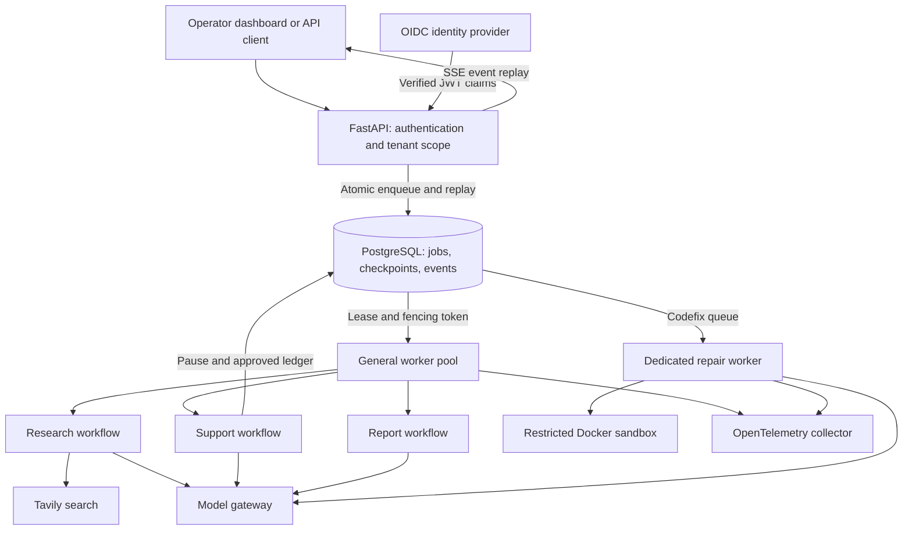
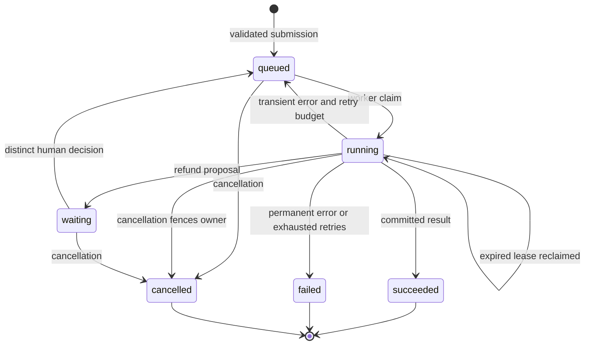
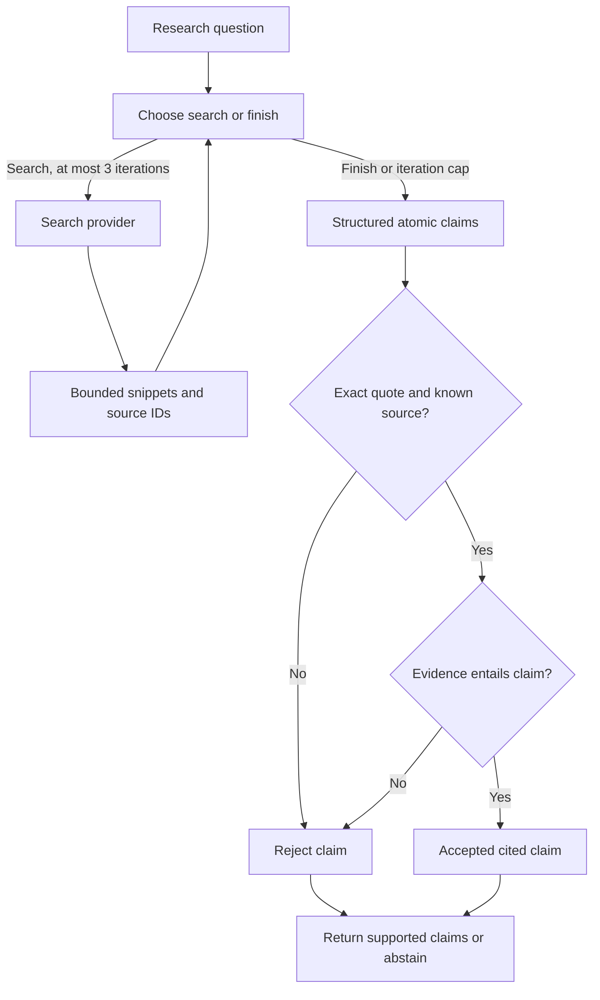
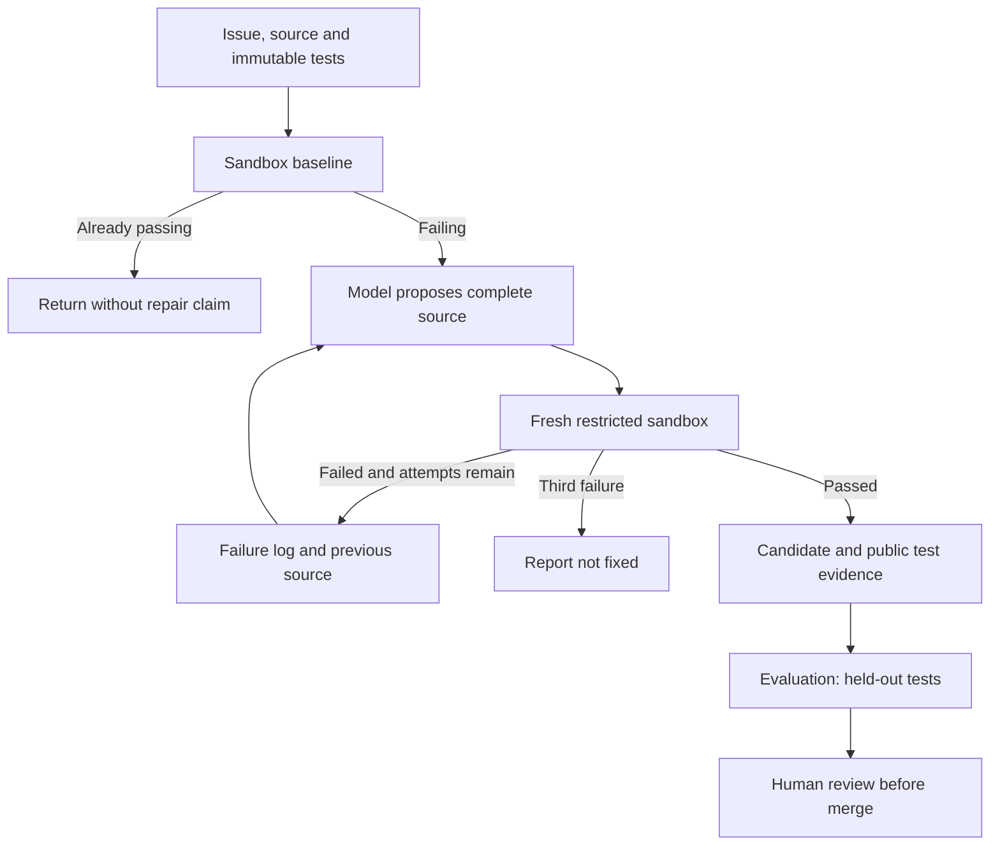
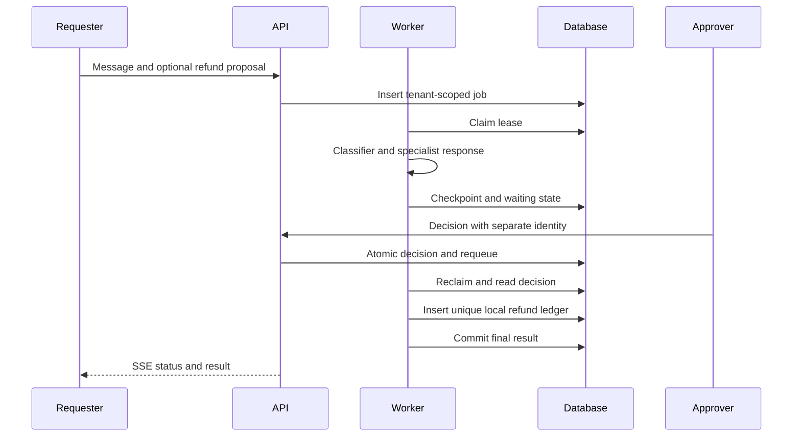
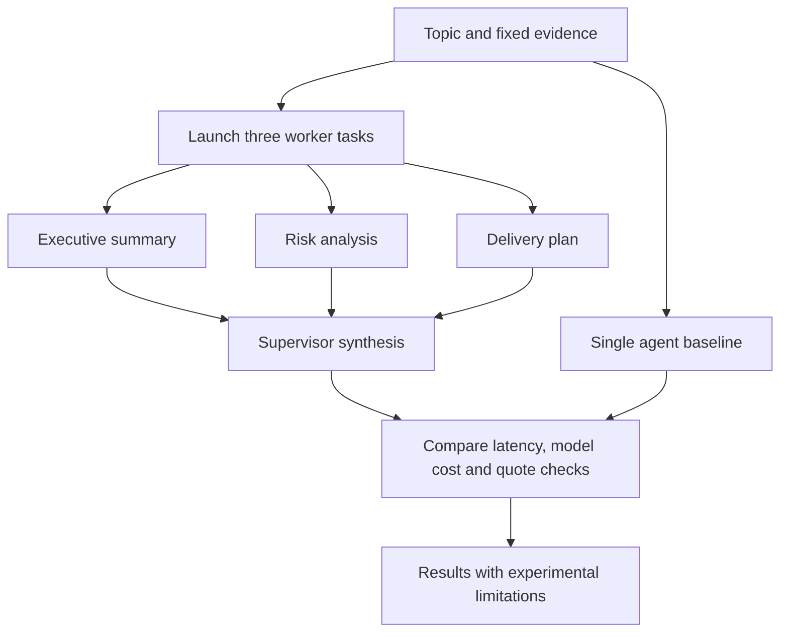
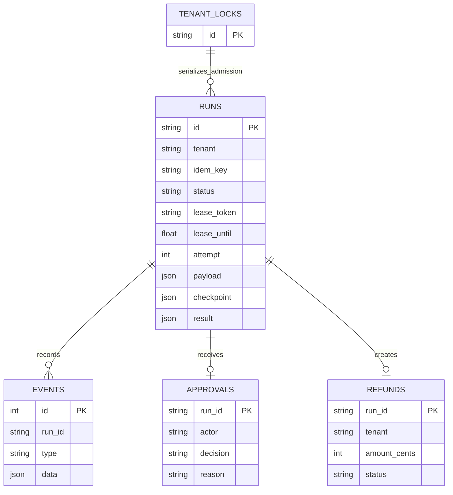
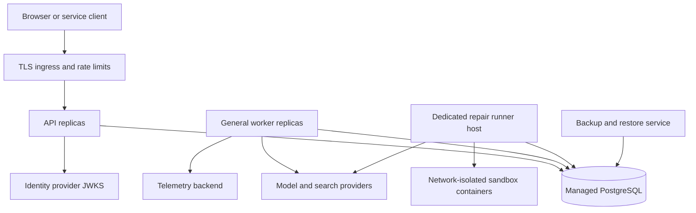

# Diagram atlas

All diagrams describe implemented code except deployment, which describes the target topology. Mermaid sources are editable in `docs/diagrams/`. The data model uses logical relationships; see architecture notes for SQL constraints.

## Architecture

## Run Lifecycle

## Research

## Codefix

## Support Approval

## Reports

## Data Model

## Deployment

