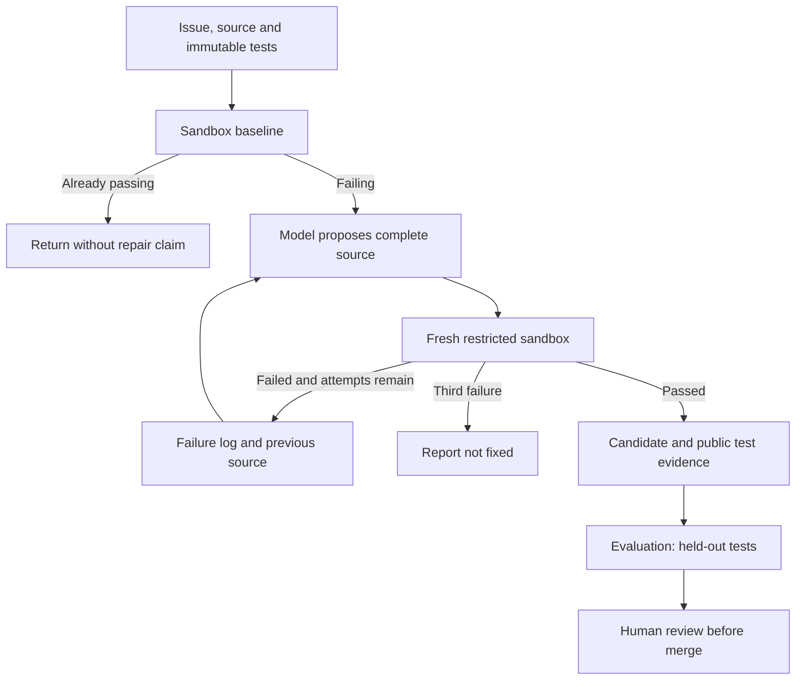

# 02 · Bounded code repair

**Pattern:** Test-driven repair with observation and reflection, maximum three attempts.

The baseline must fail before the agent claims a repair. Each attempt proposes new `solution.py` source, preserves tests, runs a fresh sandbox and feeds observed failures into the next proposal. Already-passing input returns without a repair claim. The result includes source, attempts, logs and public-test outcome.

**Run:** start a dedicated Docker-enabled code worker and submit the dashboard preset. The standard Compose worker excludes codefix. No host execution fallback exists.

**Evaluation:** `evals/data/codefix_20.json` contains 20 distinct synthetic tasks and independent hidden tests. Run `python scripts/evaluate.py --suite codefix --mode live --output evals/results/live-codefix.json`. The report includes hidden-pass rate over all selected tasks. Docker/live-model execution has not been measured in the delivered local evidence.

**Cost per run:** up to three repair model calls plus one baseline and up to three candidate containers; the evaluator may add one hidden-test container. Token-based model cost excludes runner compute.

**What I would do differently at scale:** work on isolated repository checkouts, verify patches against untouched trusted tests, use microVMs and an independent hidden evaluator, add static analysis/security scanning, and require human PR review. A candidate that passes submitted tests is not necessarily correct or safe.

See [full architecture](../../docs/ARCHITECTURE.md), [evaluation protocol](../../docs/EVALUATION.md), and [release gates](../../docs/PRODUCTION_READINESS.md).
