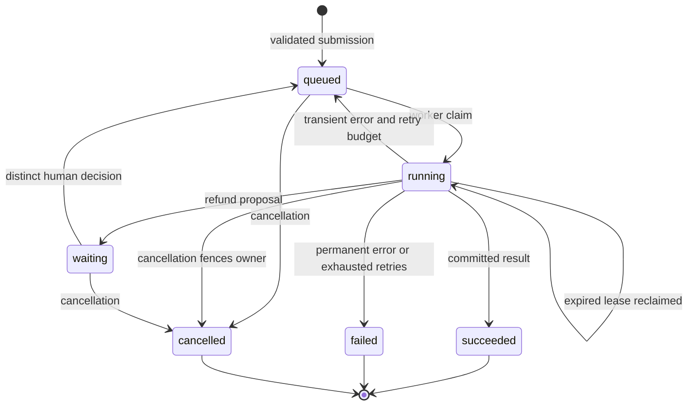

# 05 · Durable agent operations

**Pattern:** Queue-backed execution with recovery, approvals, streaming and operational evidence.

The shared platform implements idempotent submission, tenant scoping, lease fencing, checkpoints, retries, cancellation, SSE replay, OpenTelemetry and an administrative trace export. API and general workers scale separately. The code worker is isolated from the standard deployment. Compose and Kubernetes templates are included.

**Run:** follow the root README and deployment guide. A deployed endpoint has not been created in this environment. Deployment configuration is not deployment evidence.

**Evaluation:** run the full pytest suite, gated PostgreSQL/Docker checks and `python scripts/incident_drill.py`. The local drill actually expires a lease, reclaims the job and proves the stale owner cannot commit. The one-page write-up is `docs/INCIDENT.md` and labels this as an exercise, not a production outage.

**Cost per run:** platform costs include DB transactions/storage, API/worker compute, search/model requests and sandbox compute. Only completed model-token estimates are computed by the current app. No total operating-cost estimate is asserted.

**What I would do differently at scale:** add queue gauges, distributed quotas/circuit breaking, explicit schema migrations, retention automation, production login, backup restore tests, load testing and target-environment security review. Current delivery semantics are at least once, with fenced database writes.

See [full architecture](../../docs/ARCHITECTURE.md), [evaluation protocol](../../docs/EVALUATION.md), and [release gates](../../docs/PRODUCTION_READINESS.md).
