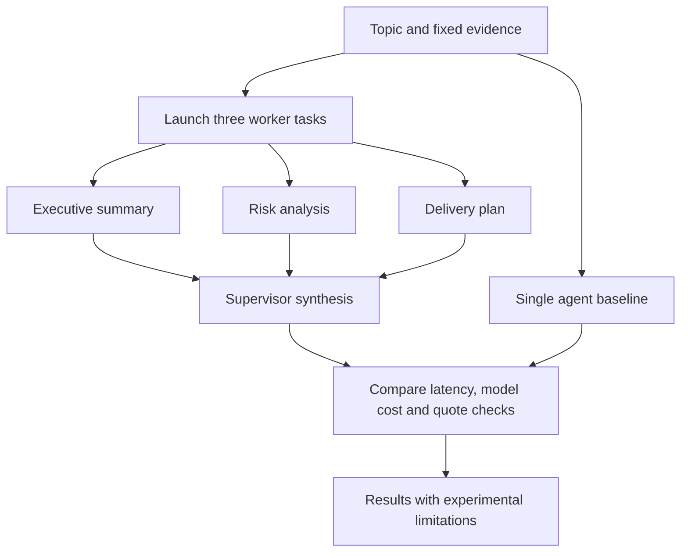

# 04 · Supervisor-worker reports

**Pattern:** Three concurrent specialists plus synthesis, compared with a single agent.

Workers analyze executive summary, risks and delivery plan using the same fixed evidence. A supervisor synthesizes the sections. A single-agent path uses the same topic/evidence/model as a comparison. Quotes are checked against the evidence, and both paths retain measured latency and model-usage records.

**Run:** choose Report studio and keep `benchmark=true`. This makes five calls total: three workers, one supervisor and one single-agent baseline.

**Evaluation:** `python scripts/evaluate.py --suite reports --mode live --output evals/results/live-reports.json` repeats the comparison five times. No live speedup/cost-saving claim is made. The paths have unequal total token budgets and fixed execution order; document those confounders. Lexical quote checks do not measure full report quality.

**Cost per run:** parallel model cost is the sum of four completed calls; single-agent cost is one call. Missing rates/usage produce null. Parallelism can reduce worker-stage waiting time while increasing token cost and supervisor latency.

**What I would do differently at scale:** randomize order, add multiple topics, blinded quality review and confidence intervals, evaluate equal-total-token budgets, and use task routing to choose whether parallelism is worthwhile.

See [full architecture](../../docs/ARCHITECTURE.md), [evaluation protocol](../../docs/EVALUATION.md), and [release gates](../../docs/PRODUCTION_READINESS.md).
