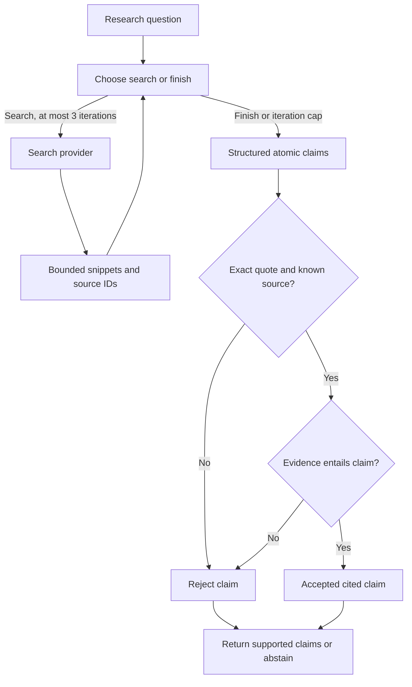

# 01 · ReAct research agent

**Pattern:** Bounded observe–act loop with cited, checked output.

The controller chooses a search query or finish action for up to three iterations. Search results supply bounded snippets with stable IDs. Synthesis creates atomic claims with quotes. Exact quotation checks run before a model entailment check. Unsupported claims are rejected; no evidence produces abstention.

**Run:** select Research in the dashboard or submit `kind=research` with a question. Requires live model and Tavily keys.

**Evaluation:** deterministic source/quote/abstention tests are included. The live smoke runner is `python scripts/evaluate.py --suite research --mode live --output evals/results/live-research.json`. No live grounding score has been measured in this package.

**Cost per run:** up to three controller calls, one answer call and up to eight entailment checks, plus at most three search calls. Actual usage is in `model_usage` events; estimated model cost is null unless rates and usage exist. Search charges are additional.

**What I would do differently at scale:** freeze source snapshots, add independent ground-truth review and source allowlists, separate the judge model, and measure answer completeness as well as quote precision. Search snippets are not complete documents and the judge is not a fact oracle.

See [full architecture](../../docs/ARCHITECTURE.md), [evaluation protocol](../../docs/EVALUATION.md), and [release gates](../../docs/PRODUCTION_READINESS.md).
