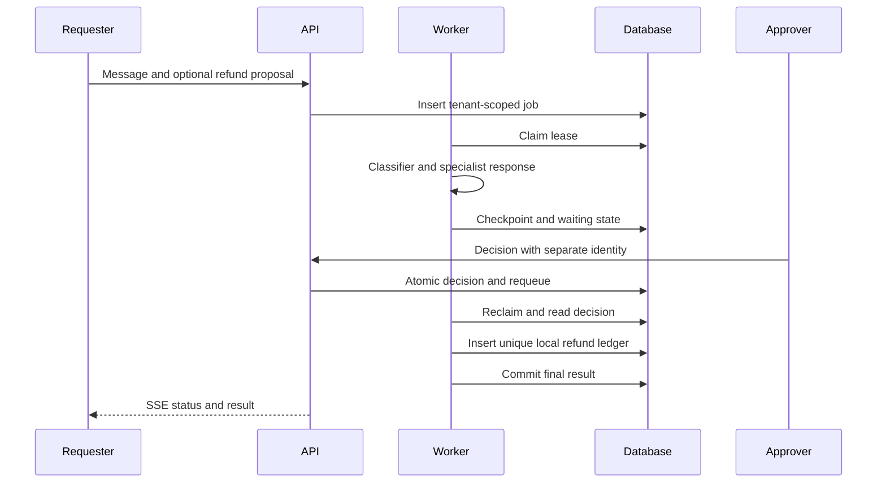

# 03 · Specialist support router

**Pattern:** Classifier → specialist → explicit human decision for refund proposals.

Billing, technical and account specialists each have bounded policies. Low model confidence and specialist escalation are surfaced. Refund detection or an explicit amount creates a proposal only when both order and amount exist. The workflow pauses. A different identity with the approver role records a decision, and approval creates a unique local pending-payment ledger entry.

**Run:** submit the support preset, then use a separate authorized OIDC identity for approval. The development token deliberately cannot approve. Routing/specialist calls are checkpointed and reused after the pause.

**Evaluation:** 50 labeled synthetic cases ship with category tags. The actually measured rules baseline is 43/50 (86%) accuracy, macro-F1 0.862. This is not live-model accuracy. The live runner is `python scripts/evaluate.py --suite support --mode live --output evals/results/live-support.json`. Approval, isolation, rejection and duplicate-ledger tests are independent of route accuracy.

**Cost per run:** two model calls for route and reply; resuming a completed checkpoint makes no new model calls. Human time, support tooling and a future payment provider are outside token cost.

**What I would do differently at scale:** calibrate confidence on a held-out set, add authoritative account/order lookup, integrate a real case-management queue for escalation, and use a transactional outbox plus reconciliation for payments. No account changes or funds transfers occur in this release.

See [full architecture](../../docs/ARCHITECTURE.md), [evaluation protocol](../../docs/EVALUATION.md), and [release gates](../../docs/PRODUCTION_READINESS.md).
